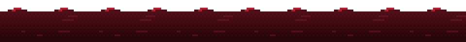

<div align="center">




</div>

### 👋 Hey, I'm Paket

- 🐍 Python's my main thing
- ☕ Picking up Java right now
- ⛏️ Learning to make Minecraft mods & plugins


### 🎣 Fins Fish

My first Minecraft mod, still in the works. It makes fishing actually fun: you reel fish in
with a little minigame, gear up with rods, hooks and bobbers, and sell your catch to fishermen.


### 📊 Sync rate

<div align="center">


<br><br>

<picture>
  <source media="(prefers-color-scheme: dark)" srcset="https://raw.githubusercontent.com/PaketikUWU/PaketikUWU/output/snake-dark.svg">
  
</picture>

<sub>🐍 just a snake munching on my commits</sub>

</div>


### 🧰 Toolkit

<div align="center">


<br>


</div>


### 📚 Fact of the day

<!--FACT:START-->
**🐍 Python · match / case**

Python 3.10 added structural pattern matching — it can take data apart, not just compare values.

```python
match command.split():
    case ["go", direction]:
        print("going", direction)
    case ["quit"]:
        print("bye!")
    case _:
        print("unknown command")
```

<sub>Oct 28, 2026 · 15 of 60 shown · tomorrow: Java</sub>
<!--FACT:END-->


### ⛏️ Mine of the day

Every day a bot goes mining at a random depth. Deeper means diamonds, higher means coal,
and every now and then a creeper ruins the trip.

<!--MINE:START-->
> ⛏️ **Trip of Oct 27, 2026:** 🔥 Nether, Y=10: 🟤 Ancient Debris ×3 · value **75**
>
> 🏆 **Record:** 🔥 Nether, Y=10: 🟤 Ancient Debris ×3 · value **75** (Oct 27, 2026)
>
> 🎒 **Inventory:** 🟠 57 · ⚪ 42 · 🟡 15 · 🔴 14 · 🔵 8 · 🟤 3
>
> 🗺️ Trips: **14** · ☠️ Failures: **4**

<details><summary>Miner's log</summary>

| Date | Trip |
|---|---|
| Oct 27, 2026 | 🔥 Nether, Y=10: 🟤 Ancient Debris ×3 · value **75** |
| Oct 26, 2026 | 🔥 Fell into lava, all the loot burned! |
| Oct 25, 2026 | 💥 A creeper sneaked up from behind, trip ruined! |
| Oct 24, 2026 | ⛰️ Overworld, Y=38: 🔵 Lapis ×8, ⚪ Iron ×2 · value **20** |
| Oct 23, 2026 | ⛰️ Overworld, Y=51: 🟠 Copper ×18, ⚪ Iron ×4 · value **26** |
| Oct 22, 2026 | 💥 A creeper sneaked up from behind, trip ruined! |
| Oct 21, 2026 | ⛰️ Overworld, Y=-30: ⚪ Iron ×8, 🟡 Gold ×4 · value **32** |

</details>
<!--MINE:END-->


